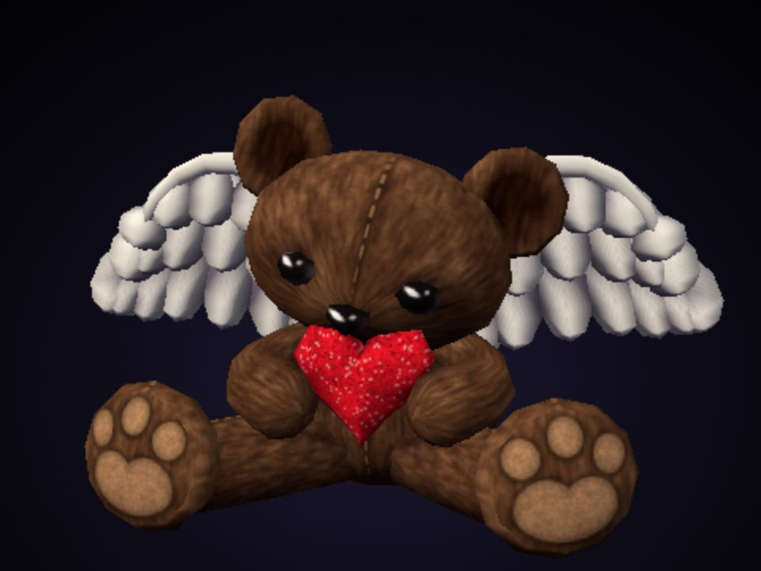

# Angel Bear — PS2-style 3D model

A low-poly angel teddy bear holding a glitter heart, modelled after a reference
photo in the style of a PlayStation 2 game asset.



## Files

| File | Use |
| --- | --- |
| `angel_bear.blend` | Open directly in Blender (saved with 4.2 LTS, opens in 4.2 and newer). Textures are packed. |
| `angel_bear.glb` | glTF 2.0 binary. Import in Blender with **File → Import → glTF 2.0**, or drop into any glTF viewer or engine. |
| `index.html` | Self-contained web viewer. Double-click to open in a browser; no server or internet needed. |
| `textures/` | The five source textures, also embedded in the `.glb` and `.blend`. |

## What makes it PS2-style

- 3,360 triangles in 15 separate, smooth-shaded parts
- Five small 8-bit palettised textures (32×32 to 128×128) with bilinear filtering
- Ambient occlusion baked into vertex colours; diffuse-only materials, with the
  eye and nose highlights painted into the texture
- The web viewer renders at 448 lines and upscales, with toggles for native
  resolution, wireframe and animation

Parts are parented under an `AngelBear` root with pivots at the head centre,
shoulders, hips and wing roots, so the head, limbs and wings can be posed in
Blender. The
model is about 0.5 m tall, +Y up in glTF (Z up after Blender import).

## Rebuilding

The model is generated procedurally. With Python 3.11:

```sh
pip install bpy==4.2.0 numpy pillow
python tools/build_model.py   # textures/*.png and angel_bear.glb
python tools/make_blend.py    # angel_bear.blend (add a directory argument to render previews)
cd viewer && npm install && npm run build   # index.html
```
