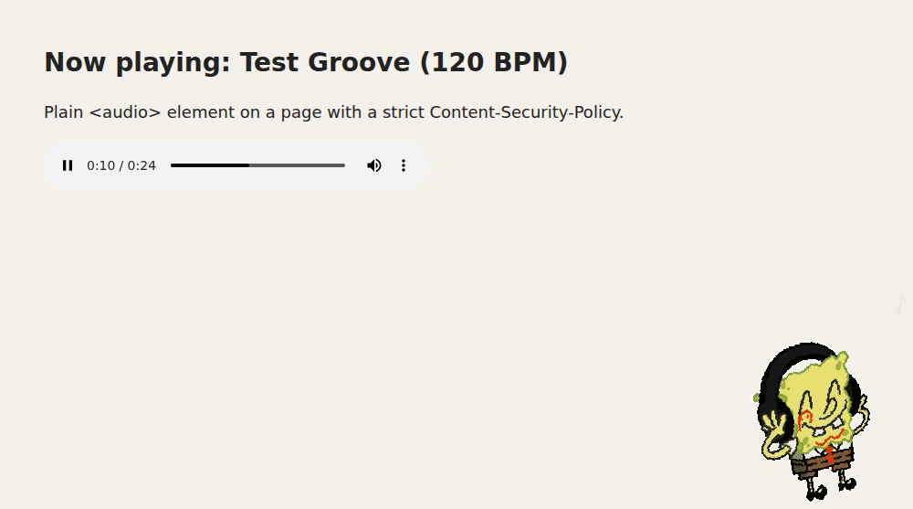

# SpongeBeat

A browser extension: whenever music plays on a page, a pixel SpongeBob in
headphones pops up in the corner and dances to the beat. He leaves again a
couple of seconds after the music stops.

## Install

Works in Chrome, Edge, Brave and other Chromium browsers (version 116 or newer).

1. Open `chrome://extensions` and switch on **Developer mode**.
2. Click **Load unpacked** and choose the `extension` folder.
3. Play music on any site. Pages that were already open need a reload first.

Click the toolbar icon to switch him off, change his size, or sync him to the
tab's audio. Drag him to move him; he remembers the spot.

## How he hears the beat

- **Automatically**, on sites whose player can be read directly, such as
  YouTube. The page's audio or video element is tapped, also inside embedded
  players, and its bass and drum hits are followed in real time.
- **Free-styling**, when something is playing but the site's audio cannot be
  read: DRM players such as Spotify, streams served from another domain, or
  sound made without a media element. He then dances at a steady 120 BPM.
- **Synced to the tab**, after you click **Sync to this tab's audio** in the
  popup. This listens to everything the tab plays, so it works on every site.
  Chrome only allows it after a click, once per tab, and shows its usual
  "tab is being captured" indicator.

Audio is analysed on your machine only; the extension makes no network requests.

## Layout

| Path | Purpose |
| --- | --- |
| `extension/content/listen.js` | Finds playing media in each frame and taps its audio |
| `extension/content/hook.js` | Reports players that are not part of the page's DOM |
| `extension/beat-detector.js` | Onset detection with tempo tracking |
| `extension/content/dancer.js` | The sprite overlay and its animation |
| `extension/background.js`, `offscreen.*` | Message relay and whole-tab listening |
| `extension/popup.*` | Toolbar popup |
| `tools/make_sprite.py` | Cuts the sprite and icons out of `tools/reference.png` (needs numpy and Pillow) |

Firefox is not supported: it lacks the tab-capture and offscreen APIs used here.
